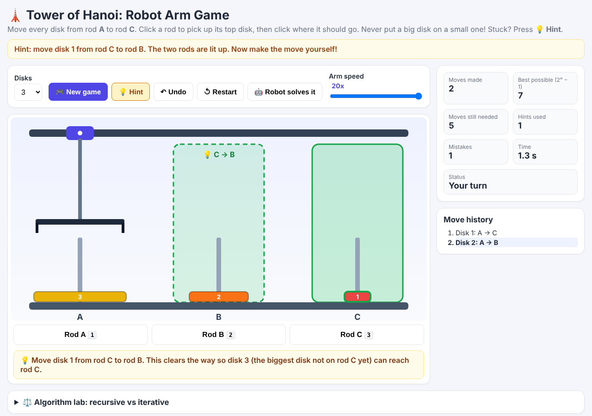

# 🗼 Tower of Hanoi Robot Arm Game

Play Tower of Hanoi against a robotic arm. Click a rod to pick up its top disk, click another rod to put it down, and the robot arm carries out your move. **Stuck? Press 💡 Hint** and the coach tells you the best next move.

A Python (FastAPI) backend is the referee and the coach. A JavaScript page draws the game.



## How to play

1. Choose the number of disks (2–10) and press **🎮 New game**.
2. Click a rod (or press `1` `2` `3`) to pick up its top disk. Click another rod to drop it.
3. Move all disks from rod **A** to rod **C**. A bigger disk can never sit on a smaller one. Illegal moves are refused with a red message.
4. **💡 Hint** (or key `H`): the two rods involved light up and a sentence explains the move. After 25 idle seconds the button pulses to remind you.
5. **↶ Undo** (`U`) takes back a move (it still counts as a move you made). **↺ Restart** starts over. **🤖 Robot solves it** finishes the puzzle from wherever you are (no stars).
6. Stars: ★★★ fewest possible moves (2ⁿ − 1) and no hints · ★★ within 1.5× of the best, or perfect with hints · ★ solved.

The earlier project part is still here under **⚖️ Algorithm lab**: the recursive and iterative solvers, the `2ⁿ − 1` check and the speed comparison.

## Folder structure

```
hanoi-robot-arm/
├── backend/
│   ├── algorithms.py   # recursive + iterative solvers, timing, 2^n - 1
│   ├── validator.py    # the referee: validate_moves (a list) + check_move (one move)
│   ├── hints.py        # NEW: the coach, best next move from ANY position
│   ├── game.py         # NEW: one game (moves, hints, undo, stars, clock)
│   ├── service.py      # start / compare / validate + the game actions (no web code)
│   └── main.py         # FastAPI routes; also serves the web page
├── frontend/           # index.html, style.css, app.js  (the playable board)
├── tests/              # test_algorithms.py, test_game.py
├── scripts/benchmark.py
├── docs/               # performance.png, benchmark.csv, sample outputs, screenshots/
├── requirements.txt
├── README.md
└── TUTORIAL.md         # step by step, explained like you are five
```

## Setup (VS Code, about 3 minutes)

1. Install Python 3.10+ from python.org (tick "Add to PATH").
2. In VS Code: **File → Open Folder…** → choose `hanoi-robot-arm`.
3. **Terminal → New Terminal**, then create a clean box for the packages:
   - Windows: `python -m venv .venv` then `.venv\Scripts\activate`
   - Mac/Linux: `python3 -m venv .venv` then `source .venv/bin/activate`
4. `pip install -r requirements.txt`
5. `uvicorn backend.main:app --reload` (or press **F5** in VS Code)
6. Open **http://127.0.0.1:8000** and play. API docs: http://127.0.0.1:8000/docs

## REST API

### Game

| Method | URL | What it does |
|---|---|---|
| POST | `/api/game/new` | `{"disks": 3}` → new game: board, `game_id`, minimum moves |
| GET | `/api/game/{id}` | Current board, counters, history |
| POST | `/api/game/{id}/move` | `{"from": 0, "to": 2}` (0=A, 1=B, 2=C). Illegal → HTTP 422 with a friendly message |
| POST | `/api/game/{id}/hint` | Best next move + explanation (counts as a hint used) |
| POST | `/api/game/{id}/undo` | Take back the last move |
| POST | `/api/game/{id}/restart` | Same game, start over |
| POST | `/api/game/{id}/solve` | Robot finishes the puzzle; returns the moves (no stars) |

### Solver and lab (unchanged)

| Method | URL | What it does |
|---|---|---|
| GET | `/api/health` | Is the server alive? |
| POST | `/api/simulations/start` | `{"disks": 3, "algorithm": "recursive"}` → all moves, 2ⁿ−1, solve time |
| GET / POST | `/api/simulations/{id}`, `/{id}/reset` | Read or reset a stored simulation |
| POST | `/api/compare` | Recursive vs iterative for one n |
| GET | `/api/compare/series?max_disks=14` | Timings for the chart |
| POST | `/api/validate` | Check any list of moves against the rules |

Errors come back as `{"detail": "..."}` and the page shows them in a red banner.

## How the hint works

The player may leave the textbook solution, so the coach looks at the board *now*:

1. Find the biggest disk **k** not on rod C.
2. Disks smaller than k must first move to the third rod (not k's rod, not C).
3. The hint is the first move of that job, or disk k itself once the way is clear.

It never wastes a move, so following hints always finishes in the fewest moves. `tests/test_game.py` proves it by checking **every** position for 1–6 disks against a brute-force shortest-path search.

Sample game session (3 disks): `docs/sample_game_session.json`. Another example hint, after disk 1 went A→C and disk 2 went A→B:

```json
{ "disk": 1, "from": 2, "to": 1, "from_name": "C", "to_name": "B",
  "message": "Move disk 1 from rod C to rod B. This clears the way so disk 3 (the biggest disk not on rod C yet) can reach rod C." }
```

## Screenshots (`docs/screenshots/`)

| | |
|---|---|
| `01_new_game.png` | New game |
| `02_disk_picked.png` | A disk picked up |
| `03_illegal_move.png` | Illegal move refused |
| `04_hint.png` | Hint lights up two rods |
| `05_win_with_hints.png` | Win after using hints |
| `06_win_perfect.png` | Perfect game, 3 stars |
| `07_robot_solving.png` | Robot finishing the puzzle |
| `08_backend_offline.png` | Backend not running |

## Tests

`pytest -q`

## Performance of the solvers (best of 3 runs; yours will differ)

| Disks | Moves | Recursive (ms) | Iterative (ms) |
|---:|---:|---:|---:|
| 10 | 1,023 | 0.12 | 0.20 |
| 14 | 16,383 | 2.29 | 3.23 |
| 18 | 262,143 | 47.3 | 68.0 |

Graph: `docs/performance.png`. Regenerate with `python scripts/benchmark.py`.

## Troubleshooting

- **Red box "Cannot reach the backend"** → the server is not running (step 5).
- **`uvicorn` not found** → activate the `.venv` (step 3) and reinstall (step 4).
- **Port busy** → `uvicorn backend.main:app --reload --port 8001`, then open port 8001.
- Robot too slow with many disks → drag **Arm speed** up to 20x.
- Games live in the server's memory: restarting the server forgets them. Press **New game**.
